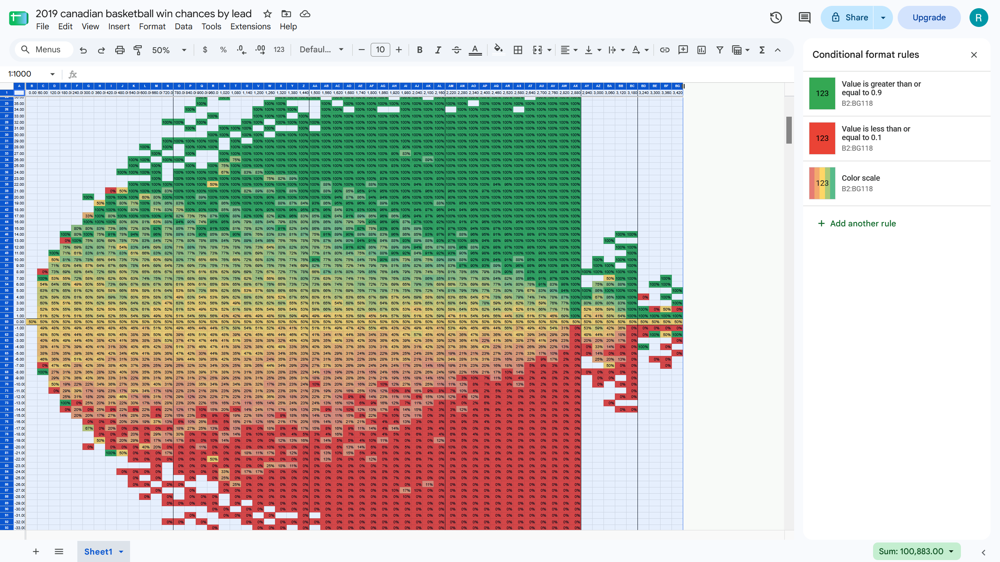

# The Question
If my team is up by X points with Y minutes remaining, what is our chance of winning?

# The answer

Dark green and dark red are "it's over" zones.

* You have to be up/down by 20 for it to be over in the first quarter
* If you're up/down by 20 at the half it's over
* If you're up/down by 12 at the start of the third quarter it's over

# The methodology
1. Obtain a large corpus of play-by-play statistics for any game with a clock
2. process into a data set of (time, spread, win) triples
3. count wins vs losses in each (time, spread) bucket

# Further research

* labeling outliers
  * who led by 58 points?
  * who blew a 28 point lead?
  * who won in OT by 14 points?
* how often did each spread happen
  * that's literally just wins+losses instead of wins/(wins+losses)
* can I make this super smooth?
  * exploit monotonicity, ^lead => ^win% and ^time => ^win%
* try simulating teams with different scoring rates
* use a dataset other than 2019 Canadian basketball
* would % lead be a better predictor?
* is there a simple function f(home points, away points, time) => win %
* those super early leads, what were their final scores?
* football gotta look crazy

# Progress
 - [x] get some data
 - [x] read data
 - [x] basic processing of data
 - [x] plot data
 - [ ] get a lot more data
 - [ ] make some pretty plots
 - [ ] publish
